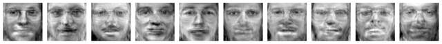

# Unsupervised Learning Experiments

[](https://github.com/utkuemec/unsupervised-learning-experiments/actions/workflows/ci.yml)


Five reproducible experiments on dimensionality reduction, clustering, density estimation and representation learning, using the **Olivetti faces** (400 images, 40 people), **MNIST** (70k digits) and a synthetic **Swiss roll**. Each script answers a concrete question, uses seeded stratified train/validation/test splits, and writes its metrics to [`results/metrics.json`](results/metrics.json).


*Held-out test faces (top) reconstructed by the tuned sparse autoencoder (middle) and by PCA with the same 128-dimensional code (bottom).*

## Results at a glance

| # | Experiment | Key result |
|---|---|---|
| 1 | **PCA / Incremental PCA** on MNIST | 154 of 784 components keep 95% of the variance (5.1× compression, reconstruction MSE 0.0034) |
| 1 | **Kernel PCA** on a Swiss roll (GridSearchCV over kernel × γ) | Best: RBF, γ = 0.046, but 2-component kPCA + logistic regression only reaches 0.57 CV accuracy — a 2-D kernel projection does not unroll this manifold |
| 2 | **Face recognition baseline:** PCA (100, whitened) + RBF-SVM | **98.8% test accuracy** (val 92.5%, 5-fold CV 89.6%) |
| 2 | **K-Means** distances as features (k = 100 by silhouette) | 75% val accuracy — compact (100-D) but far below the PCA baseline |
| 2 | **DBSCAN** with ε from the k-distance curve | 46 clusters, 53% noise, ARI 0.04 — density clustering breaks down with 10 samples per identity in high dimensions |
| 3 | **Agglomerative clustering**, k = 40 | Ward/Euclidean recovers identities best (**ARI 0.49, NMI 0.81**) vs Manhattan-average (0.29) and cosine-average (0.16) |
| 4 | **Gaussian Mixture** (BIC over 4 covariance types × 1–10 components) | Diagonal covariance, 2 components; flags **100%** of rotated and flipped faces and 35% of heavily darkened faces as anomalies (2% false-positive threshold) |
| 5 | **Sparse autoencoder (PyTorch)**, 3-fold CV over code size × L1 penalty | Best: 128-D code, L1 = 1e-4. Test MSE **0.0058 vs 0.0023 for PCA** at the same code size |

### Takeaways

- **Simple, well-regularised baselines win on small data.** Whitened PCA + SVM reaches 98.8% on 40 identities, and linear PCA reconstructs faces ~2.6× better than a deep autoencoder trained on 320 images.
- **Clustering metrics disagree.** Silhouette keeps rising with *k* for every linkage, while identity recovery (ARI) peaks for Ward linkage — internal metrics alone would pick the wrong model.
- **Density models make cheap anomaly detectors.** A 2-component GMM in PCA space gives genuine faces a mean log-likelihood of +8.5 versus −187 (flipped) and −387 (rotated); photometric changes (darkening, −18) are much harder to catch.



*New faces sampled from the fitted GMM and projected back to pixel space.*

## Reproduce

```bash
pip install -r requirements.txt
python src/run_all.py           # full runs (~15 min on a laptop CPU), writes results/
python src/run_all.py --quick   # smaller data and sweeps, used by CI (~1.5 min)
```

Or run a single experiment, e.g. `python src/04_gmm.py`. Figures are written to `results/figures/`.

## Repository layout

```
src/
├── common.py               # seeded splits, data loading, figure + metrics helpers
├── 01_pca_kernel_pca.py    # PCA, Incremental PCA (MNIST); Kernel PCA + GridSearchCV (Swiss roll)
├── 02_kmeans_dbscan.py     # silhouette sweep, K-Means features vs PCA+SVM, DBSCAN
├── 03_hierarchical.py      # agglomerative clustering with 3 metrics, ARI / NMI, dendrogram
├── 04_gmm.py               # BIC/AIC model selection, sampling, anomaly detection
├── 05_autoencoder.py       # PyTorch sparse autoencoder, k-fold tuning, PCA comparison
└── run_all.py
results/metrics.json        # numbers quoted above
```

## Notes

These started as assignments for COMP 257 (Unsupervised & Reinforcement Learning) at Centennial College and were rebuilt as standalone, reproducible experiments. Changes from the originals:

- one shared, seeded 60/20/20 stratified split; the test set is only touched once, after model selection
- autoencoder rewritten in PyTorch and trained on pixels; the original applied a sigmoid/BCE loss to PCA coordinates, which are not bounded to [0, 1]
- DBSCAN ε chosen from the k-distance curve instead of a fixed guess; clustering quality reported with ARI / NMI against held-back labels
- headless figure generation, metrics persisted to JSON, lint + smoke test in CI
